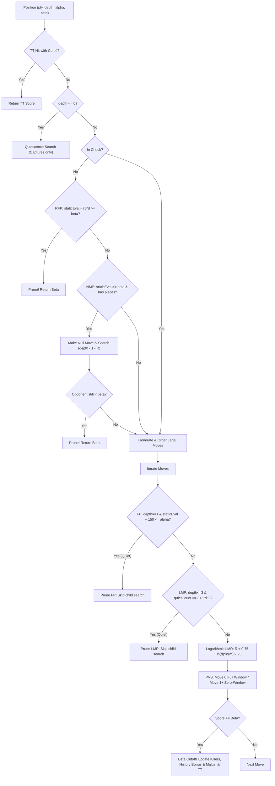

# Ironfang: Chess Engine Algorithmic & Evaluation Theory

A complete, formal theoretical reference for the search algorithms, pruning heuristics, board representations, and evaluation functions powering the **Ironfang** chess engine.

---

## Table of Contents
1. [Foundations of Computer Chess Search](#1-foundations-of-computer-chess-search)
   - [1.1 Minimax Game Tree Formulation](#11-minimax-game-tree-formulation)
   - [1.2 Alpha-Beta Pruning & Fail-Hard Semantics](#12-alpha-beta-pruning--fail-hard-semantics)
   - [1.3 Move Ordering & Branching Factor Reduction](#13-move-ordering--branching-factor-reduction)
2. [State Representation & Transposition Table](#2-state-representation--transposition-table)
   - [2.1 Zobrist Hashing](#21-zobrist-hashing)
   - [2.2 Transposition Table Architecture & Replacement Policy](#22-transposition-table-architecture--replacement-policy)
   - [2.3 Graph History Interaction (GHI) & TT Repetition Blindness Bypass](#23-graph-history-interaction-ghi--tt-repetition-blindness-bypass)
3. [Search Control & Window Narrowing](#3-search-control--window-narrowing)
   - [3.1 Iterative Deepening](#31-iterative-deepening)
   - [3.2 Aspiration Windows](#32-aspiration-windows)
   - [3.3 The Horizon Effect & Quiescence Search](#33-the-horizon-effect--quiescence-search)
4. [Pruning Algorithms (Sub-Tree Elimination)](#4-pruning-algorithms-sub-tree-elimination)
   - [4.1 Reverse Futility Pruning (RFP / Static Null Move Pruning)](#41-reverse-futility-pruning-rfp--static-null-move-pruning)
   - [4.2 Null Move Pruning (NMP) & Zugzwang Prevention](#42-null-move-pruning-nmp--zugzwang-prevention)
   - [4.3 Frontier Futility Pruning (FP)](#43-frontier-futility-pruning-fp)
   - [4.4 Late Move Pruning (LMP)](#44-late-move-pruning-lmp--move-count-pruning)
5. [Search Reductions & Scout Windows](#5-search-reductions--scout-windows)
   - [5.1 Principal Variation Search (PVS / NegaScout)](#51-principal-variation-search-pvs--negascout)
   - [5.2 Late Move Reductions (LMR)](#52-late-move-reductions-lmr)
6. [Complete Search Decision Pipeline](#6-complete-search-decision-pipeline)
7. [Hand-Crafted Evaluation (HCE) Theory](#7-hand-crafted-evaluation-hce-theory)
   - [7.1 Material & Game Phase Interpolation](#71-material--game-phase-interpolation)
   - [7.2 Piece-Square Tables (PST)](#72-piece-square-tables-pst)
   - [7.3 Pawn Structure Analysis](#73-pawn-structure-analysis)
   - [7.4 Piece Mobility via Magic Bitboards](#74-piece-mobility-via-magic-bitboards)
   - [7.5 King Safety, Pawn Shields & Open File Penalties](#75-king-safety-pawn-shields--open-file-penalties)
   - [7.6 Opening Queen Excursion Penalties](#76-opening-queen-excursion-penalties)
   - [7.7 Rook Activity: Open Files & Seventh Rank Infiltration](#77-rook-activity-open-files--seventh-rank-infiltration)
   - [7.8 Minor Piece Dynamics: Knight Outposts & Bishop Pair](#78-minor-piece-dynamics-knight-outposts--bishop-pair)

---

## 1. Foundations of Computer Chess Search

### 1.1 Minimax Game Tree Formulation
Chess is modeled mathematically as a **two-player, zero-sum game of perfect information**. 
- One player (White) aims to maximize the static evaluation function $f(s)$.
- The other player (Black) aims to minimize $f(s)$.

In a standard chess position, the average branching factor $b \approx 35$. A brute-force Minimax traversal to depth $d = 8$ plies (half-moves) would require visiting:
$$N = b^d \approx 35^8 \approx 2.25 \times 10^{12} \text{ positions (2.25 trillion)}$$
Calculating this in real-time under tournament time controls is physically impossible.

### 1.2 Alpha-Beta Pruning & Fail-Hard Semantics
Instead of visiting every branch, **Alpha-Beta search** tracks two dynamic boundaries $[\alpha, \beta]$:
* **$\alpha$ (Alpha)**: The minimum score the side to move is guaranteed to achieve elsewhere in the game tree.
* **$\beta$ (Beta)**: The maximum score the opponent will ever allow the side to move to achieve. If a child node yields a score $\ge \beta$, the opponent would have chosen an alternative move earlier to prevent this outcome.

```
                  [Root: White to move]
                     /              \
                Move A               Move B
               (eval: +2.0)          (White tests B...)
                                     /
                                Opponent reply b1: eval -0.5
                                Opponent reply b2: eval -4.0 (White blunders Queen)
                                --> Score drops below alpha (+2.0)
                                --> Prune b3, b4, b5!
```

When a move produces a score $\ge \beta$, the node triggers a **Beta Cutoff (fail-high)**. Under optimal move ordering, Alpha-Beta cuts the search space down to the square root of Minimax:
$$\mathcal{O}(b^d) \longrightarrow \mathcal{O}(b^{d/2})$$
At depth 8, optimal Alpha-Beta visits only $\approx 1.5 \times 10^6$ nodes instead of $2.25 \times 10^{12}$.

### 1.3 Move Ordering & Branching Factor Reduction
The speedup of Alpha-Beta depends entirely on **searching the strongest move first**. If the first move examined at a node causes a beta cutoff, the remaining ~34 legal moves are discarded without search.

Ironfang establishes move priority using four distinct heuristics:
1. **Hash Move**: The best move retrieved from the Transposition Table (priority $+100,000$).
2. **Winning / Equal Captures (MVV-LVA)**: *Most Valuable Victim – Least Valuable Attacker*. Evaluated as:
   $$\Delta_{\text{capture}} = V(\text{victim}) - V(\text{attacker})$$
   A Pawn capturing a Queen ($P \times Q$, $\Delta = +800$) is examined before a Queen capturing a Pawn ($Q \times P$, $\Delta = -800$).
3. **Killer Moves**: Up to 2 non-capturing moves per ply that previously caused a beta cutoff in an adjacent sibling node (`killerMoves[ply][0]` and `killerMoves[ply][1]`).
4. **History Heuristic & Malus**: A table `historyHeuristics[color][from][to]` bounded within $[-50000, +50000]$:
   - **Bonus**: When a quiet move refutes a branch (causes a beta cutoff), it receives $+\min(400, \text{depth}^2)$.
   - **Malus**: All preceding quiet moves tried at the same node that failed to achieve a cutoff receive $-\min(400, \text{depth}^2)$. This actively suppresses quiet moves that repeatedly fail to refute branches.

---

## 2. State Representation & Transposition Table

### 2.1 Zobrist Hashing
Different move orders frequently transpose into the exact same board configuration:
* Line 1: `1. d4 Nf6 2. c4 e6`
* Line 2: `1. c4 e6 2. d4 Nf6`

To detect transpositions in $\mathcal{O}(1)$ time, every piece on every square, side to move, castling right, and en-passant file is mapped to a unique 64-bit pseudo-random integer. When a move is played, XOR operations ($\oplus$) incrementally maintain the 64-bit key:
$$\text{key}_{\text{new}} = \text{key}_{\text{old}} \oplus Z[\text{piece}][\text{from}] \oplus Z[\text{piece}][\text{to}] \oplus Z_{\text{blackToMove}}$$

### 2.2 Transposition Table Architecture & Replacement Policy
Ironfang reserves a direct-mapped table of **4,194,304 entries (64 MiB)**. Each slot is encoded in a compact 16-byte struct:
```cpp
struct TTEntry {
    uint64_t key;        // 8 bytes: full 64-bit Zobrist key
    int eval;            // 4 bytes: score normalized relative to ply
    uint16_t packedMove; // 2 bytes: best move
    uint8_t depth;       // 1 byte: search depth
    uint8_t flag : 2;    // TT_EXACT (0), TT_UPPER (1), TT_LOWER (2)
    uint8_t age  : 6;    // 6-bit generation counter
};
```
- **Indexing**: Fast power-of-two bitmask indexing: `index = key & TT_MASK` (where `TT_MASK = TT_SIZE - 1`).
- **Score Normalization**: Mate scores are stored as distance from the current node rather than root distance:
  $$\text{eval}_{\text{stored}} = \begin{cases} \text{score} + \text{ply} & \text{if score} > \text{MATE\_THRESHOLD} \\ \text{score} - \text{ply} & \text{if score} < -\text{MATE\_THRESHOLD} \\ \text{score} & \text{otherwise} \end{cases}$$
- **Replacement Policy**: Combines search depth with generation age:
  $$\text{score}_{\text{old}} = \text{entry.depth} - (\text{currentAge} - \text{entry.age}), \quad \text{score}_{\text{new}} = \text{depth}$$
  The new result overwrites the slot if $\text{score}_{\text{new}} \ge \text{score}_{\text{old}}$.

### 2.3 Graph History Interaction (GHI) & TT Repetition Blindness Bypass
In computer chess, the search space is not a pure tree but a **Directed Acyclic Graph (DAG)** where multiple distinct paths lead to identical board configurations. While Zobrist keys uniquely identify the board state, they do **not** encode the path history that led to the node.

#### The GHI Repetition Failure Mode
1. Suppose at Move $51$, Position $P$ is evaluated as winning ($+3.5\text{ pawns}$) along a tree path where $P$ had never occurred before. The TT caches `eval = +350` at depth $d$.
2. At Move $53$, Position $P$ has already occurred twice in the real game.
3. When search considers entering $P$ at $\text{ply} = 1$, standard TT probing finds a key match with sufficient depth and triggers an **instant cutoff**, returning $+350\text{ cp}$.
4. Because the cutoff terminates search at $\text{ply} = 1$, the engine never expands $\text{ply} = 2$, where the opponent has a forced checking move that completes a **3-fold repetition draw** ($0.0\text{ cp}$).
5. The engine plays the move, assuming it retains $+3.5\text{ pawns}$, and walks directly into a draw.

#### The Resolution (`hasAppearedInGameHistory`)
To preserve TT speed while guaranteeing soundness:
$$\text{AllowTTCutoff}(s, \text{ply}) = \neg \text{hasAppearedInGameHistory}(s, \text{ply})$$
Where `hasAppearedInGameHistory` scans `board.repetitionPath` within the reversible $50$-move window ($t_{\text{current}} - \text{halfmoveClock} \le t \le t_{\text{current}} - 2$):
```cpp
bool hasAppearedInGameHistory(const BitBoard& board, int ply) {
    if (board.halfmoveClock < 2 || board.pathDepth <= 1) return false;
    const int currentIndex = board.pathDepth - 1;
    const int earliestRelevantIndex = std::max(0, currentIndex - board.halfmoveClock);
    for (int index = currentIndex - 2; index >= earliestRelevantIndex; index -= 2) {
        if (board.repetitionPath[index] == board.zobristKey) {
            if (currentIndex - index > ply) return true; // Occurred in actual game history
        }
    }
    return false;
}
```
If `hasAppearedInGameHistory` returns true:
- The TT cutoff is **bypassed**.
- `ttMove` is **retained** as the highest-priority move ordering hint.
- Child moves are expanded normally, allowing `isRepetitionDraw()` to evaluate repeating branches at $0\text{ cp}$ (or $-10\text{ cp}$), forcing the root to select winning non-repeating alternatives.

---

## 3. Search Control & Window Narrowing

### 3.1 Iterative Deepening
Rather than launching an immediate deep search, the engine searches sequentially:
$$\text{Depth 1} \longrightarrow \text{Depth 2} \longrightarrow \text{Depth 3} \longrightarrow \dots \longrightarrow \text{Depth } N$$
Shallow iterations consume less than $10\%$ of total clock time, but they seed the Transposition Table with accurate hash moves. When Depth $N$ begins, the best move from Depth $N-1$ is already available, ensuring immediate beta cutoffs on move 0.

### 3.2 Aspiration Windows
At $\text{depth} \ge 4$, instead of searching the infinite window $[-\infty, +\infty]$, Ironfang bounds the search around the prior iteration's evaluation:
$$[\alpha, \beta] = [\text{prevScore} - \Delta, \; \text{prevScore} + \Delta] \quad (\Delta = 30\text{ cp})$$
Narrow windows generate vastly more beta cutoffs. If the true score falls outside the window (fail-high or fail-low), the window is widened by $1.5\times$ ($\Delta \leftarrow \Delta + \Delta/2$) until resolved.

### 3.3 The Horizon Effect & Quiescence Search
When search reaches its nominal depth limit ($\text{depth} \le 0$), it cannot simply stop and call static evaluation. For example, if White plays $Q \times R$ on ply 8, static evaluation would claim White is $+5$ pawns ahead, failing to notice that Black can play $B \times Q$ on ply 9.

**Quiescence Search** mitigates this:
1. It restricts move generation strictly to legal captures and promotions.
2. **Stand-Pat**: Before searching any capture, static evaluation is computed. If $\text{staticEval} \ge \beta$, the position is already too advantageous for the opponent to allow, triggering an immediate cutoff.
3. The search terminates only when all tactical tension has resolved into a quiet position.

---

## 4. Pruning Algorithms (Sub-Tree Elimination)

### 4.1 Reverse Futility Pruning (RFP / Static Null Move Pruning)
Near leaf nodes ($\text{depth} \le 3$), when the side to move is not in check:
$$\text{If } \text{staticEval} - (75 \times \text{depth}) \ge \beta \implies \text{Return } \beta$$
If our static advantage exceeds $\beta$ by more than $75\text{ cp}$ (depth 1), $150\text{ cp}$ (depth 2), or $225\text{ cp}$ (depth 3), the opponent cannot realistically overcome this margin within the remaining plies. Ironfang cuts off immediately without generating or ordering moves.

### 4.2 Null Move Pruning (NMP) & Zugzwang Prevention
In chess, having the turn is almost always an advantage. If the side to move **passes the turn** (playing a "null move"), granting the opponent two consecutive turns, and the opponent *still* cannot beat $\beta$ with reduced search, our position is overwhelmingly winning.

#### Algorithm
1. **Safety Checks**: `allowNull == true`, `depth >= 3`, `ply > 0`, `!inCheck`, `beta < MATE_THRESHOLD`, `staticEval >= beta`.
2. **Zugzwang Guard**: In king-and-pawn endgames, having to move can be a disadvantage (Zugzwang). Passing would falsely appear beneficial. Therefore, NMP is strictly disabled if the side to move has only pawns remaining:
   $$\text{hasNonPawns} = (\text{pieces} \setminus (\text{pawns} \cup \text{king})) \ne \emptyset$$
3. **Execution**: The side to move is toggled, en-passant is cleared, and search executes at reduced depth:
   $$R = 3 + \frac{\text{depth}}{6}$$
   $$\text{nullScore} = -\text{minimaxAlphaBeta}(\text{board}, \text{depth} - 1 - R, -\beta, -\beta + 1, \text{ply} + 1, \text{allowNull} = \text{false})$$
4. If $\text{nullScore} \ge \beta$, search takes an immediate beta cutoff.

### 4.3 Frontier Futility Pruning (FP)
At frontier nodes ($\text{depth} == 1$), when not in check:
$$\text{If } \text{staticEval} + 150 \le \alpha \implies \text{Prune quiet move}$$
A quiet piece move to an empty square that does not give check or promote cannot plausibly swing the evaluation by more than $150\text{ cp}$ in one ply. If $\text{staticEval} + 150$ cannot even reach $\alpha$, the move is guaranteed to fail low and is skipped before calling child search.

### 4.4 Late Move Pruning (LMP / Move Count Pruning)
In positions near the leaves of the tree ($\text{depth} \le 3$), when not in check and not in a mate-score search:
$$\text{Quiet Move Threshold: } L = 3 + 3 \times \text{depth}^2$$
- At $\text{depth} = 1$: $L = 6$ quiet moves.
- At $\text{depth} = 2$: $L = 15$ quiet moves.
- At $\text{depth} = 3$: $L = 30$ quiet moves.

Once the move ordering has evaluated $L$ quiet candidate moves without finding a refutation or improvement above $\alpha$, any further quiet non-checking moves have a vanishingly small probability ($<0.05\%$) of being superior. They are pruned directly without searching the child tree. Tactical moves (captures, promotions, and checks) are strictly exempt.

---

## 5. Search Reductions & Scout Windows

### 5.1 Principal Variation Search (PVS / NegaScout)
Due to move ordering, Move 0 is the best move $>85\%$ of the time. PVS leverages this asymmetry:
- **Move 0**: Searched with the standard full window $[-\beta, -\alpha]$.
- **Moves $1, 2, 3\dots$**: Assumed to be inferior. Tested with an ultra-tight **Zero-Window (Scout Search)**:
  $$[-\alpha - 1, -\alpha]$$
- Because the window size is only $1\text{ cp}$, scout searches fail low rapidly with minimal sub-tree expansion.
- **Re-Search**: If and only if a scout search beats $\alpha$ ($\text{score} > \alpha$), our assumption was incorrect. The move is re-searched with the full window $[-\beta, -\alpha]$ to determine its exact evaluation.

### 5.2 Late Move Reductions (LMR)
Quiet moves ordered late in the list (`moveIndex >= 3` at `depth >= 3`) that are not tactical checks, promotions, or killer moves have an exponentially decreasing probability of being the optimal move.

Instead of flat single-ply reductions, Ironfang employs a **Logarithmic Multi-Ply Reduction Table**:
$$R_{\text{base}}(d, m) = \left\lfloor 0.75 + \frac{\ln(d) \times \ln(m)}{2.25} \right\rfloor$$

#### Contextual Dynamic Adjustments
The base reduction $R$ is dynamically modulated by move characteristics:
1. **Giving Check**: If the quiet move delivers check, reduce less: $R \leftarrow \max(0, R - 1)$.
2. **Killer Move**: If the move is stored in the killer table for this ply, reduce less: $R \leftarrow \max(0, R - 1)$.
3. **History Heuristic Modulator**:
   - High History ($\text{history} > +10,000$): Move has demonstrated prior tactical merit $\implies R \leftarrow \max(0, R - 1)$.
   - Low / Negative History ($\text{history} < -10,000$): Move has repeatedly failed $\implies R \leftarrow R + 1$.
4. **Depth Floor Guard**: $R$ is clamped to $[0, \text{childDepth} - 1]$ ensuring the reduced child search executes at $\text{depth} \ge 1$.

#### Two-Tiered Re-Search Protocol
1. **Scout Search**: The move is searched at $\text{reducedDepth} = \text{childDepth} - R$ with zero-window $[-\alpha - 1, -\alpha]$.
2. **First Re-Search**: If $\text{score} > \alpha$, the reduction was overly optimistic. The move is re-searched at full $\text{childDepth}$ with zero-window $[-\alpha - 1, -\alpha]$.
3. **PVS Re-Search**: If the full-depth zero-window search still beats $\alpha$, it is re-searched with the full alpha-beta window $[-\beta, -\alpha]$.

---

## 6. Complete Search Decision Pipeline



---

## 7. Hand-Crafted Evaluation (HCE) Theory

Ironfang's evaluation function computes a static score from the perspective of the side to move using domain-specific chess heuristics.

### 7.1 Material & Game Phase Interpolation
Piece valuations are standardized as:
* Pawn: $100\text{ cp}$
* Knight: $300\text{ cp}$
* Bishop: $320\text{ cp}$
* Rook: $500\text{ cp}$
* Queen: $900\text{ cp}$
* King: $20,000\text{ cp}$

Positional scores smoothly blend between **Middlegame (MG)** and **Endgame (EG)** weights using a 24-point phase counter derived from remaining non-pawn material:
$$\text{phase} = 4 \times (\text{Queens}) + 2 \times (\text{Rooks}) + 1 \times (\text{Bishops} + \text{Knights})$$
$$\text{Score} = \frac{\text{MG} \times \text{phase} + \text{EG} \times (24 - \text{phase})}{24}$$

### 7.2 Piece-Square Tables (PST)
Each piece type utilizes a 64-element table reflecting positional utility:
* **Knights**: Strongly rewarded in the center (e4, d4, e5, d5); heavily penalized on rim squares (a1, h1, a8, h8).
* **Bishops**: Encouraged along long open diagonals.
* **Kings**: Rewarded for castling into safety behind pawn shields during middlegame; incentivized to centralize during endgames.

### 7.3 Pawn Structure Analysis
- **Passed Pawns**: A pawn with no opposing pawns on its file or adjacent files ahead of it receives progressive rank-based bonuses ($0, 10, 20, 40, 80, 160\text{ cp}$).
- **Isolated Pawns**: Pawns with no friendly pawns on adjacent files receive a structural penalty ($-15\text{ cp}$).
- **Doubled Pawns**: Friendly pawns stacked on the same file receive mobility penalties ($-20\text{ cp}$).

### 7.4 Piece Mobility via Magic Bitboards
Mobility reflects the number of safe squares a piece attacks:
- Sliding piece attacks (Rooks, Bishops, Queens) are computed via **Magic Bitboard hashing** in $\mathcal{O}(1)$ time.
- Higher mobility correlates strongly with initiative and tactical control.

### 7.5 King Safety, Pawn Shields & Open File Penalties
- **Pawn Shield**: Rewards intact $f, g, h$ (or $a, b, c$) pawns guarding a castled king.
- **Uncastled King on Open Central Files**: If a king remains on $d$ or $e$ files and the central file is open or semi-open, Ironfang assesses dynamic penalties ($-35\text{ to } -60\text{ cp}$), preventing kings from being trapped in the center.

### 7.6 Opening Queen Excursion Penalties
Premature queen sorties before minor piece development (Knights and Bishops) are penalized ($-25\text{ to } -50\text{ cp}$), preventing early queen blunders.

### 7.7 Rook Activity: Open Files & Seventh Rank Infiltration
- **Open Files**: Rooks on files devoid of any pawns control vital breakthrough corridors and receive $+25\text{ cp}$.
- **Semi-Open Files**: Rooks on files devoid of friendly pawns exert direct pressure against opposing pawns and receive $+12\text{ cp}$.
- **Seventh Rank Infiltration**: A rook occupying the 7th rank (rank 7 for White, rank 2 for Black) when the opponent's king is restricted to the back rank or enemy pawns occupy the 7th rank receives $+20\text{ cp}$.

### 7.8 Minor Piece Dynamics: Knight Outposts & Bishop Pair
- **Bishop Pair Advantage**: Retaining both light- and dark-squared bishops confers asymmetric tactical versatility and diagonal control, rewarded with $+30\text{ cp}$.
- **Knight Outposts**: A knight established on advanced ranks (ranks 4, 5, or 6) that is solidly defended by a friendly pawn and permanently unassailable by opposing pawns on adjacent files receives $+25\text{ cp}$ (central files c, d, e, f) or $+15\text{ cp}$ (flank files).
